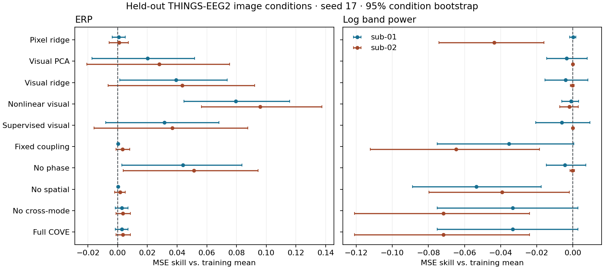
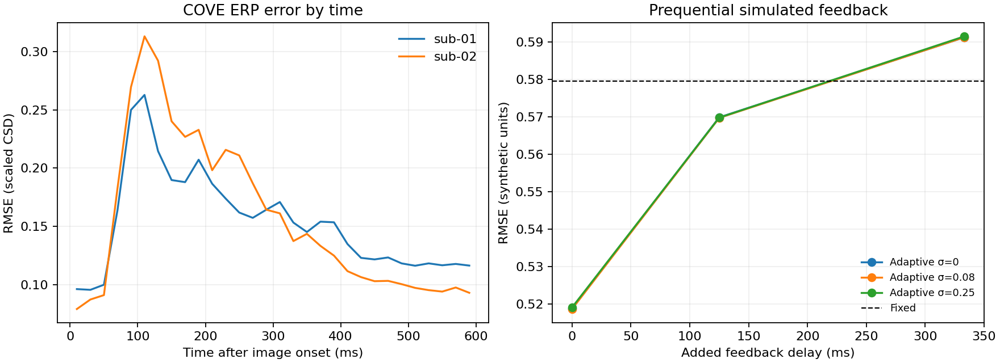

# Distributed oscillatory encoding and THINGS-EEG2 pilot

The [advanced encoder report](ADVANCED.md) covers the current browser demonstration, hybrid ERP calibration, interacting dynamics, and inverse refinement. This page records the initial pilot and its original benchmarks.

This study evaluates image-to-EEG prediction and visual representation in software. COVE models complex states at 25 retinotopic sampling sites; its modeled phase, frequencies, and coupling describe the encoder. EEG is used as an observational regression target. The simulated feedback experiment updates a readout against software-generated observations.

## Reproduce

Run from the repository root with Python 3.12. The two-participant download is about 1.47 GB. Use one subject for the smallest pilot. The research environment is separate from the original Gradio and HTTP applications.

```bash
python3.12 -m venv .venv-research
. .venv-research/bin/activate
python -m pip install -r research/requirements.txt
export OPENBLAS_NUM_THREADS=1 VECLIB_MAXIMUM_THREADS=1
python -m research.acquire --subjects 01 02
python -m research.run things --subjects 01 02 --out research/results/things.json
python -m research.run synthetic --out research/results/synthetic.json
python -m research.plot
python -m pytest -q tests/test_cove.py
```

For the existing application test suite, install the root requirements in its own environment and run `python -m pytest -q`. In `frontend/`, run `npm ci`, `npm test`, `npm run check`, and `npm run build`. The TypeScript reference test compares the complex states and coupling to Python on shared 64 × 64 pixels. Regenerate its fixture with `python -m tests.generate_cove_reference`.

For the optional browser calibration:

```bash
python -m research.calibrate --subject 01 --out research-data/sub-01-calibration.json
```

Run the existing workbench on one still image, open **Inspect distributed COVE**, and load the JSON using **ERP calibration JSON**. The file contains the seed-17 train-only ERP fit and visual decoder. Browser decode and resize can differ from OpenCV preprocessing. The calibration UI applies to still images. Videos and image sequences expose the spatial states, coupling, and modeled site spectrogram; the luminance reconstruction interpolates the foveated inputs. With a calibration loaded, the oscillatory code reconstruction uses the learned pixel decoder. Both media and calibration are processed locally.

## Data and alignment

- **THINGS-EEG2.** The pilot uses the public 200 Hz, baseline-z-scored, current-source-density derivative from the EEG fusion encoding OSF project and its embedded stimulus table. The preprocessed train partition from the parent study was outside the pilot scope. The original test stimulus archive and metadata came from the image-set OSF component. NeMAR supplied a pinned BIDS snapshot of per-session events and the stimulus manifest. [Original study and code](https://github.com/gifale95/eeg_encoding) · [EEG derivative](https://osf.io/3eayd/) · [Stimulus component](https://osf.io/y63gw/) · [NeMAR release](https://www.nemar.org/dataset/nm000232)
- **Licenses and privacy.** NeMAR lists the EEG dataset as CC BY 4.0. The image archive's separate terms reserve image copyrights to the original owners and limit use to research under the stated terms. The fusion derivative OSF component metadata returned no license field. Only aggregate metrics and synthetic fixtures are committed. Local source EEG, events, images, and fitted calibration artifacts are ignored by Git. Treat release participant codes as pseudonyms. [NeMAR terms](https://www.nemar.org/dataset/nm000232) · [THINGS image terms](https://osf.io/download/3765v/)
- **THINGS-EEG1.** OpenNeuro ds003825 provides an independent rapid serial visual presentation corpus with 1,854 concepts. An external benchmark would require its own event-to-image join, condition checks, channel harmonization and splitting by concept. It was investigated for suitability. [Dataset](https://openneuro.org/datasets/ds003825) · [Original study](https://doi.org/10.1038/s41597-021-01102-7)
- **SSVEP.** The Wang et al. 35-participant, 64-channel, 40-target benchmark is suited to an independent frequency and stimulus-trigger phase check. Its flicker targets and trial protocol call for a separate task and evaluation. It was investigated for suitability. [Original study and publisher dataset location](https://pubmed.ncbi.nlm.nih.gov/27849543/)

The loader hashes the exact OSF NumPy archives before loading their pickled dictionaries. It checks participant ID, EEG dimensions `[200, 80, 63, 180]`, sample grid from −100 to 795 ms, and exact agreement between the embedded and separately released ordered image tables. Every condition ID joins to a stimulus-manifest record, category folder, image filename, and event category across four sessions. Each session had 4,056 image events and 24 other events. The derivative holds 80 retained trials per condition across sessions. The raw event tables include extra image presentations, and the derivative lacks a retained repeat-to-event key. The checks establish condition-level alignment. No repeat-to-event assignment enters the benchmark.

The ERP target is the repeat mean at O1, Oz, O2, PO7, PO3, POz, PO4 and PO8, binned at 20 ms over 0–600 ms. The second target is the repeat mean of log band power from individual epochs over the same interval. A 120-sample Hann periodogram uses squared FFT modulus divided by sample rate times window energy. Bin centers are grouped in half-open 4–8, 8–13, 13–30 and 30–45 Hz bands. Log is applied after band averaging within a trial. The 600 ms window provides about 1.67 Hz FFT spacing. Scaled CSD values are reported in derivative units. The presentation interval was approximately 200 ms, so later response bins can include overlapping stimulus responses.

## Visual representation

The OpenCV path converts to grayscale and area-resizes to 64 × 64. A five-by-five grid samples normalized image positions radially. If the square-grid radius is $r$, the image eccentricity is $e=(3^{r/\sqrt{2}}-1)/2$ and direction is preserved. This oversamples central space. Inputs to each site include Gaussian luminance $L$, local contrast $c=\sqrt{\max(0,E[G^2]-E[G]^2)}$, and two banks of 15 × 15 cosine/sine Gabors at .10 and .21 cycles/pixel and four directions. Kernels are DC-removed and L2-normalized, with Gaussian width 2.8 pixels. The high-frequency bank operates on the residual after Gaussian blur. Quadrature responses are divided by $(0.15+c)(1+k e^2)$, where $k=1$ at the low scale and $5$ at the high scale. The site samples use bilinear interpolation.

The temporal terms are $m_t=\tanh((L_t-L_{t-1}) f_s/12)$ and $v_t=\operatorname{Im}(g_t\bar g_{t-1})/(0.1+|g_t\bar g_{t-1}|)$ for the low-scale Gabor response. Both are initialized at zero. $v_t$ is a bounded frame-to-frame phase-change proxy. The site/nominal-mode drive is

$$
u = .5g_{\rm lo}+.25g_{\rm hi}+.15(L-.5)+.1(m+iv), \qquad d=u/(1+|u|).
$$

Each mode uses one orientation pair. The mode frequencies label internal state dynamics. The multi-orientation grating design is a modeling choice about input organization.

## COVE coupling and stability

For nearby sites $j$ (self and four-neighbor adjacency), the contrast-dependent spatial operator is

$$
W_{ij}(c)=\frac{\exp[-a\|p_i-p_j\|_1-b|c_i-c_j|]}
{\sum_{k\in N_i}\exp[-a\|p_i-p_k\|_1-b|c_i-c_k|]}.
$$

Training minimizes mean masked complex drive-prediction error plus $0.0002(a^2+b^2)$ over a 4 × 4 nonnegative slope grid. For this objective, the diagonal is removed and rows renormalized, making exact self-copy unavailable. The operator restores self-edges for the dynamics. This is self-supervised learning of a two-parameter input-conditioned operator, with EEG learning performed by a separate readout. The prototype's fixed adaptive heuristic motivated the local graph. The candidate improvement combines masked predictor learning with a provable stability bound on state-dependent phase modulation.

Take video frames as piecewise-constant inputs and integrate using $\lceil 100/f_s\rceil$ substeps per frame with step $h$. Each clip resets its state. For mode index $k=0,\dots,3$, set $\rho=e^{-h/.09}$, nominal frequency $f_k\in\{6,10,20,40\}$ Hz, and $D=.8d+.2Wd$. The update is

$$
z'_{ik}=\rho\exp\{ih[2\pi f_k+2.4 k\,\mathrm{Im}(z_{i0})]\}(Wz_k)_i+(1-\rho)D_{ik}.
$$

The unit complex multiplier preserves modulus; convex averaging with $W$ bounds both $Wz$ and $D$ by one. Thus the unit polydisc is invariant. For two states in the polydisc driven by the same data, the bound $|e^{iu}-e^{iv}|\le |u-v|$ and $\|W\|_\infty=1$ give a one-step Lipschitz constant at most $\rho(1+7.2h)<1$, since $1+7.2h\le e^{7.2h}$ and $7.2<1/.09$. The bound applies to the forward recurrence per fixed input sequence. For still images, the same drive is held for five frame intervals at 24 fps and the terminal complex state supplies the readout. Video readouts sample state at frame boundaries; the browser spectrogram uses the summed real site state at the internal timebase.

## Evaluation and inverse

The split unit is an original THINGS concept ID in the 200-condition release subset, with 120 train, 40 validation and 40 test conditions at seeds 17, 29 and 43. The 80 repeats are averaged per condition before scoring. The same split seeds keep stimulus exposure comparable for both participants. This is an internal concept-held-out pilot on the publisher's test-image pool. The three splits overlap. Per-split confidence intervals resample 40 whole test conditions, or whole clips in the synthetic experiment, 1,000 times. They describe within-split uncertainty and do not support a population-level interval. The JSON includes paired COVE-versus-visual MSE differences. The real ERP phase diagnostic is a magnitude-weighted circular cosine over approximately 5–12 Hz for observed and predicted residual ERPs after subtracting the train-average ERP. It measures onset-aligned waveform consistency of the condition average. There is no single-trial phase decoding in this experiment.

The ridge baselines use 12 × 12 grayscale pixels or conventional distributed luminance, local contrast, motion, phase-change proxy, and Gabor amplitude features. The PCA variant uses up to 32 input directions. The supervised visual model uses up to 32 left singular vectors of the training input/response cross-covariance. The nonlinear comparator uses 200 seeded tanh random features with a learned ridge readout, matching COVE's 200 real input coefficients. The fixed and ablated COVE readouts have the same width. Diagnostics remove complex phase from the driver, replace the spatial operator with identity, or set cross-mode modulation to zero. Training data determine all trainable transforms. Validation selects a ridge penalty from seven values, each scaled by the training design's centered energy per coefficient. Test targets are used for scoring.

A linear ridge pixel decoder is fitted on training data. Let $X$ be flattened complex code using real coordinates, $X_0$ the forward code, $U=X-X_0$, $P$ the known input pixels, and $R$ and $B$ the pixel and EEG readout weights. The inverse minimizes

$$
\|XR+r-P\|_F^2/n_P
+.15\|UB\|_F^2/n_Y+.06\|U\|_F^2
+.02\|\Delta_t U\|_F^2+.035\|(I-W)U\|_F^2.
$$

$n_P$ and $n_Y$ are the output dimensions. The EEG term keeps predictions near their forward-model reference and has no measured test EEG input. The temporal and graph penalties regularize changes to the forward code. A gradient step uses the reciprocal of an upper bound on the Hessian spectral norm, with $\|\Delta_t\|_2^2\le4$. Each complex mode update is truncated at distance .15 from its anchor and at its radial intersection with the unit disk. This radial clipping is a feasible numerical update, without a global optimum claim. The graph and temporal terms are soft penalties.

For simulated calibration, the experiment introduces a known drift and Gaussian observation noise on held-out synthetic clips. Given the last eligible observation, it applies normalized least mean squares with weight decay and a Frobenius-norm cap of 4. Prediction at frame $t$ may use observations only through $t-1-d$, where $d$ is the added delay. Synthetic responses are analytic functions of generated grating parameters with observation noise. Clips are independently generated and split by clip. There are no physical feedback or actuator paths.

## Results

Values below are means across three split seeds. Skill is $1-\mathrm{MSE}_{model}/\mathrm{MSE}_{train\ mean}$, expressed as a percentage. Each real split assessed 40 distinct conditions per participant.

| Model | Sub-01 ERP | Sub-02 ERP | Sub-01 log power | Sub-02 log power |
| --- | ---: | ---: | ---: | ---: |
| Pixel ridge | −0.23% | 0.34% | 0.07% | −2.49% |
| Visual PCA | 2.22% | 3.58% | 0.03% | 0.02% |
| Conventional visual ridge | 2.87% | 4.34% | −0.05% | 0.00% |
| Matched-width nonlinear visual | 8.09% | 10.47% | −1.07% | −0.27% |
| Supervised visual | 2.85% | 4.07% | −0.14% | −0.01% |
| Fixed coupling | 0.22% | 0.36% | −0.95% | −2.46% |
| No visual phase | 4.39% | 5.78% | −0.01% | −0.21% |
| No spatial coupling | 0.12% | 0.16% | −1.46% | −1.14% |
| No cross-mode modulation | 0.32% | 0.40% | −0.96% | −2.76% |
| Full COVE | 0.32% | 0.40% | −0.96% | −2.76% |
| COVE after inverse refinement | 0.35% | 0.43% | −1.67% | −3.38% |



In seed 17, the COVE ERP bootstrap intervals were −0.16% to 0.70% for sub-01 and −0.11% to 0.87% for sub-02. The matched-width nonlinear baseline outperformed full COVE on both participants' mean ERP skill. Removing visual phase improved ERP skill in this pilot. Cross-mode modulation made little difference. The masked fit selected $(a,b)=(0,2)$ across the real-data splits and $(0,0)$ across the synthetic splits. The observed residual-ERP circular cosine ranged from −0.007 to 0.116 across participants and seeds. There was no phase-specific null test or single-trial phase comparison.

Inverse refinement reduced real-stimulus 12 × 12 reconstruction RMSE from 0.1862 to about 0.0847 when permitted to use the known input pixels. ERP skill changed by about 0.03 percentage points; log-power skill decreased. Synthetic visual reconstruction RMSE fell from 0.0679 to 0.0574, while synthetic response skill was close to the training mean with either code. With observation noise SD 0.08, simulated feedback RMSE at 0, 3 and 8 added frames was 0.519, 0.570 and 0.591, respectively, versus 0.580 for the fixed readout. Extra delay reversed the benefit at eight frames, approximately 333 ms before the one-frame eligibility delay.



The aggregate data are in [THINGS-EEG2 results](results/things.json) and [synthetic results](results/synthetic.json). This pilot used Python 3.12.16 on macOS arm64. A larger study would need the original publisher train/test partition, independent participants and sessions, matched regularization and architecture tuning on a larger cohort, and external visual EEG and SSVEP evaluation. Single-frame stationary inputs provide little evidence about temporal model advantages. A small performance change across two people does not establish generalization, causal stimulation, or visual induction. The current evidence supports this pilot report. A manuscript was deferred.
